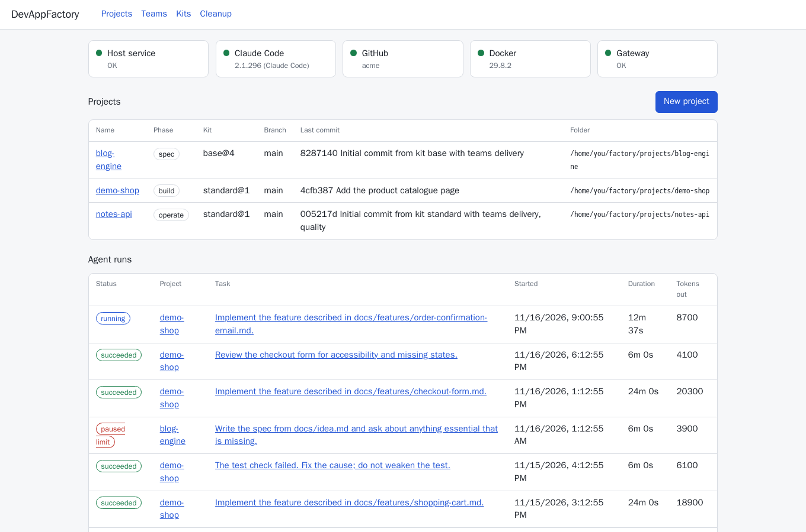
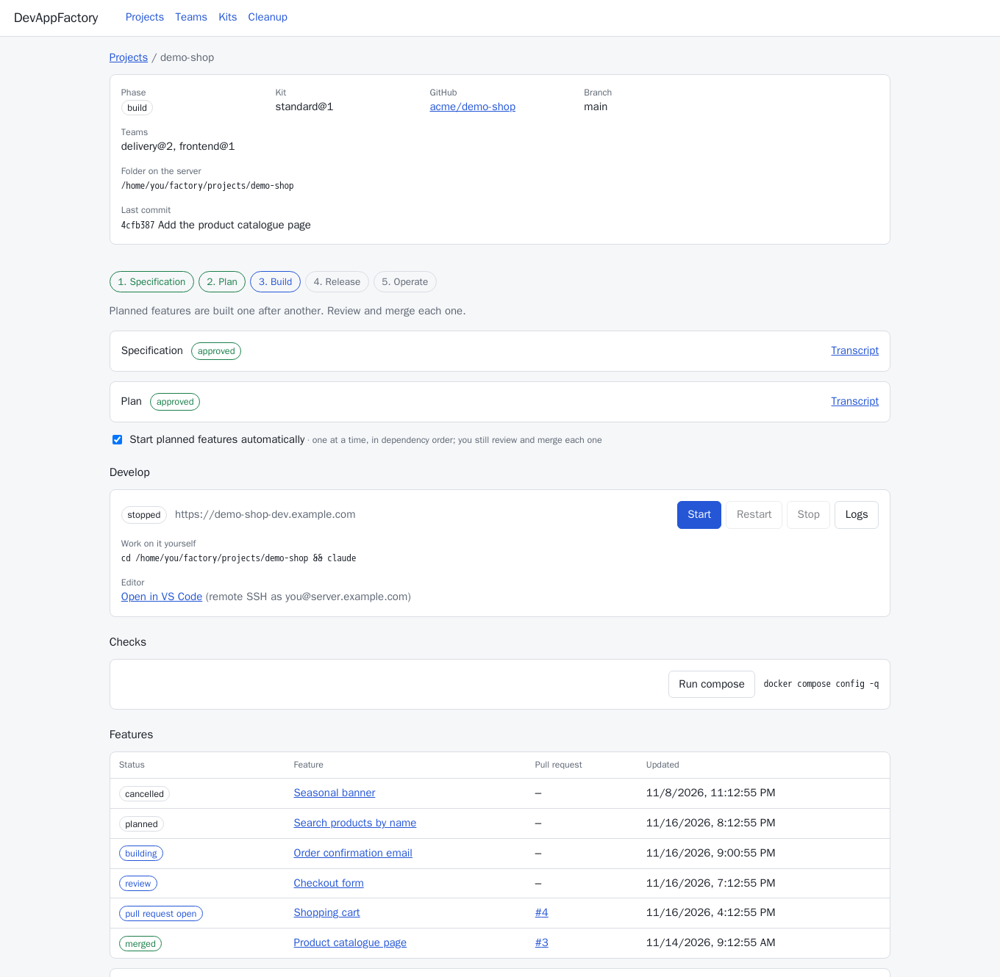
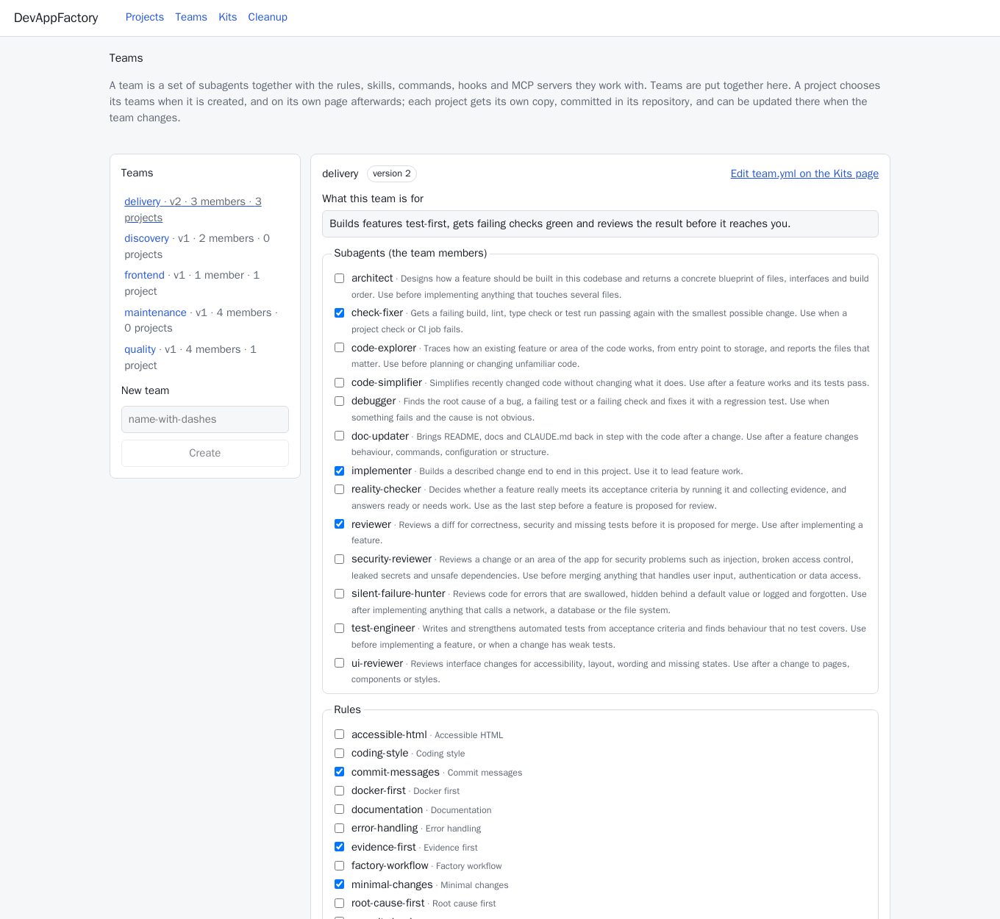
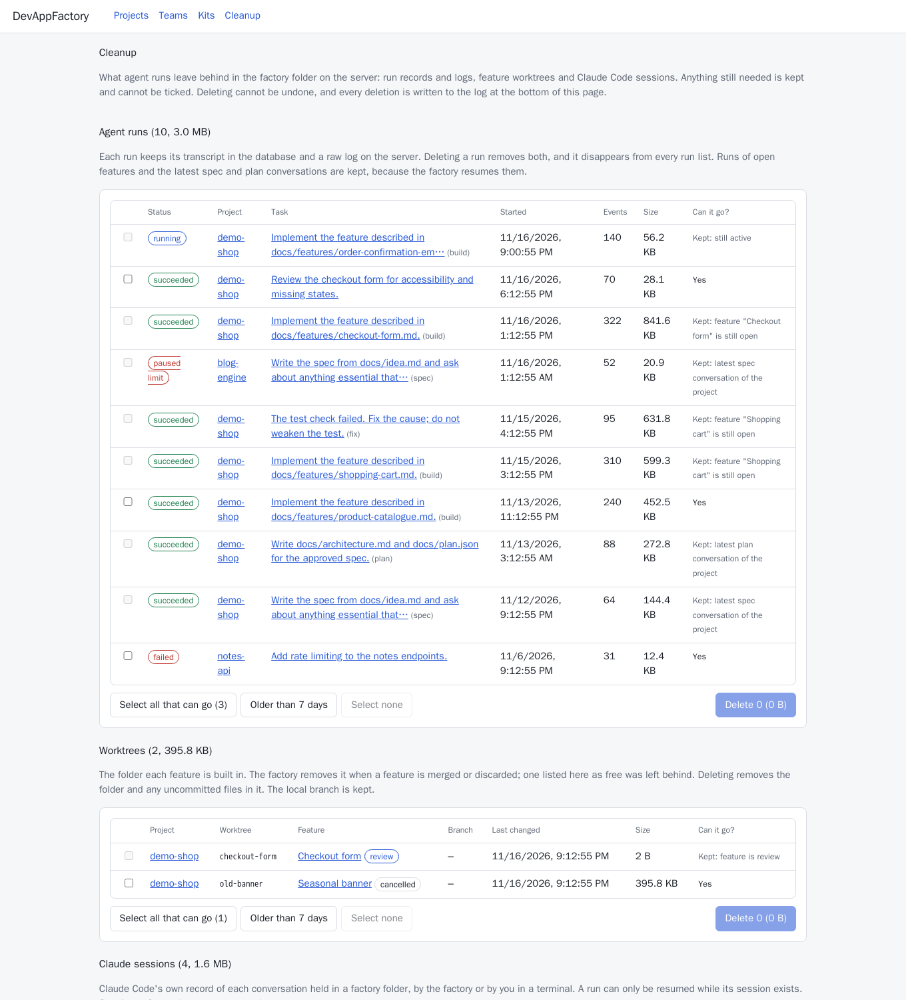

# DevAppFactory

**A self-hosted factory that takes an app from idea to a running deployment on your own server.** Claude Code agents write the spec, the plan and the code; deterministic checks decide whether each step passed; you approve the spec, review every diff and promote to production.



> **Status: early.** Built for one user on one server. Read [Security](#security) before installing: the factory starts agents and deployments on the machine it runs on.

## What it does

- **Creates projects.** A GitHub repository, a local clone, an app scaffold, and the Claude Code configuration (a *kit*) that lets agents work well in it.
- **Specifies and plans with you.** An agent turns your idea into a spec with acceptance criteria, then into a plan of small features. Nothing is built until you approve.
- **Builds features in isolation.** Each feature gets its own branch and worktree. An agent implements it, the project's checks run without any agent involved, and a failing check goes back to the agent to fix.
- **Keeps you in control.** You review the diff, the factory opens the pull request, and you merge. Agents never push, merge or deploy.
- **Deploys.** Preview after every merge, production by promoting what is on preview, with health checks and automatic return to the previous version on failure.
- **Gives agents a team.** Reusable subagents, skills, rules, commands and hooks are grouped into teams (delivery, discovery, quality, frontend, maintenance) that a project chooses when it is created.
- **Stays out of your way.** A project is an ordinary git repository with standard Claude Code files, so you can open it in your editor or in Claude Code at any time and work alongside the agents.

## How a feature reaches production

```
idea ─► spec ─► plan ─► feature ─► checks ─► your review ─► pull request ─► merge ─► preview ─► production
        agent   agent    agent     factory      you           factory        you     factory      you
```

## Screenshots

Taken from a demo installation with sample data.

| | |
|---|---|
| **A project:** phase, teams, dev environment, checks and its features by status | **Teams:** put together from the library's subagents, rules, skills, commands and hooks |
|  |  |
| **Cleanup:** what agent runs leave behind, what must stay and why, and a log of deletions | |
|  | |

Design and decisions: [docs/DESIGN.md](docs/DESIGN.md). The kit library and where its methods come from: [kits/README.md](kits/README.md).

## How it is put together

| Part | Where | Runs as |
|---|---|---|
| `apps/web` | React UI | Built into the `factory-app` image |
| `apps/server` | API, orchestration, SQLite | Container `factory-app` |
| `apps/host` | Host service: git, `gh`, Docker, Claude Code | systemd user service `factory-host` |
| `kits/` | Seed kit library: subagents, skills, rules, commands, hooks, teams | Copied to `$FACTORY_HOME/kits` on first start |

`factory-app` has no Docker socket and no credentials. It reaches the server only through the fixed operations of `factory-host`, over a Unix socket.

## Requirements

- Linux server with systemd, Docker with Compose, Node.js 18 or later, git and `openssl`.
- [Claude Code](https://claude.com/claude-code) installed and logged in as the user that runs the factory (`claude auth login`).
- [GitHub CLI](https://cli.github.com) logged in (`gh auth login`).
- A domain whose names point at the server: each app is served as `https://<name>.<domain>`, so use a wildcard DNS record or one record per name (`factory`, `<app>`, `<app>-dev`, `<app>-preview`). Ports 80 and 443 must be free for the bundled gateway. To try the factory on one machine, use `localhost` as the domain; the browser then warns about a local certificate.

## Install

Three steps on the server, as the user that will run the factory:

```bash
./deploy/install-host.sh
```

This creates `.env` (secret key, factory home, user and group), builds `factory-host` and starts it as a systemd user service. Review `.env` against [.env.example](.env.example).

Then set up the gateway, with your own domain and an email address for certificate notices:

```bash
./deploy/install-gateway.sh example.com you@example.com
```

It asks for a login name and password, starts a Caddy container that obtains certificates by itself, and publishes the factory's UI behind that login. Last, start the UI:

```bash
docker compose up -d --build
```

The factory is then at `https://factory.<your domain>`.

To keep the host service running after logout and start it at boot:

```bash
sudo loginctl enable-linger $USER
```

To update, pull, then run `./deploy/install-host.sh`, `./deploy/install-gateway.sh` and `docker compose up -d --build` again. The gateway script keeps your sites, logins and settings.

### The gateway

The bundled gateway lives in `$FACTORY_HOME/gateway` and is managed with its `scripts/gateway.sh`: `status`, `logs`, `sites`, `passwd <user>`, `unpasswd <user>`, `users`. The factory adds and removes app sites itself.

To use a gateway you already run, skip `install-gateway.sh`, set `GATEWAY_DIR` and `FACTORY_DOMAIN` in `.env`, and publish `factory-app:3000` through it with authentication. It must offer the commands and files listed at the top of [apps/host/src/gateway.ts](apps/host/src/gateway.ts).

## Configuration

All settings live in `.env` at the repository root, read by both the host service and the container. [.env.example](.env.example) documents each one.

| Setting | Required | Default | Purpose |
|---|---|---|---|
| `FACTORY_SECRET_KEY` | yes | generated at install | Encrypts stored deployment variables |
| `FACTORY_HOME` | yes | `~/factory` at install | Database, kit library, projects, worktrees, deployments, run logs |
| `FACTORY_UID`, `FACTORY_GID` | yes | installing user | User the container runs as, to reach the host socket |
| `GATEWAY_DIR` | no | `$FACTORY_HOME/gateway` (the bundled one) | Folder of the gateway with `scripts/gateway.sh` |
| `FACTORY_DOMAIN` | no | written by `install-gateway.sh` | Apps are published as `<name>.<domain>` |
| `GATEWAY_CONTAINER` | no | `gateway-caddy` | Gateway container, for health checks |
| `FACTORY_EDGE_NETWORK` | no | `factory-edge` | Network shared by the gateway and every app |
| `FACTORY_APP_NETWORK` | no | `devappfactory-network` | Network on which the gateway reaches the UI |
| `GH_OWNER` | no | the `gh` account | Owner of created repositories |
| `FACTORY_SSH_TARGET` | no | `<user>@factory.<domain>` | Target of the "Open in VS Code" link |
| `MAX_CONCURRENT_RUNS` | no | `2` | Agent runs at the same time |

## Security

- **Never expose the UI without authentication.** It has no login of its own yet; it relies on the gateway's, which `install-gateway.sh` sets up. Anyone who reaches it can start agents and deployments on your server.
- **Agents are not sandboxed.** They run as your user in the project folder. A command allowlist and a guard hook limit mistakes; they are not a security boundary.
- **Hooks and MCP servers in the kit library are programs** that run on the server. Only versions you have committed in the library reach a project.
- Secrets for deployments are stored encrypted and written only to deployment folders, which agents cannot read.

Report vulnerabilities as described in [SECURITY.md](SECURITY.md).

## Development

```bash
cd apps/host && npm install && npm run build && npm test
```

The server and web app build inside the image (`docker build .`), which also type-checks them. See [CONTRIBUTING.md](CONTRIBUTING.md).
